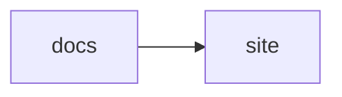

# starlight-docs-harness

A reusable Starlight application that publishes any repository's `docs/` tree to GitHub Pages or Cloudflare Pages with zero JavaScript in the consuming repository.
The consumer keeps writing plain markdown in `docs/`; the harness supplies the site shell, the build, and the deployment.

## How content mounts

At build time each rendered subdirectory of the consumer's `docs/` directory is symlinked into `src/content/docs/`, so every subdirectory becomes a sidebar section.
Subdirectories named in `EXCLUDE_DIRS` (default `notes`) are not linked and do not render.
The reserved `files/` subdirectory is not linked either; it ships verbatim instead (see [Static files](#static-files)).

The site root renders the consumer's `docs/index.md` or `docs/index.mdx` when one exists, with the same link rewriting and frontmatter handling as every other page.
Without one, the harness's bundled landing page renders instead; having both `index.md` and `index.mdx` fails the build.
Other files at the top level of `docs/` are not mounted.

Starlight's landing-page frontmatter works in the root index:

```markdown
---
title: Consumer docs
template: splash
hero:
  tagline: What this project does, in one line.
  image:
    file: ./guides/logo.svg
  actions:
    - text: Get started
      link: /consumer/guides/getting-started/
---
```

Hero `actions` links are used verbatim rather than rewritten, so write them as site routes including the base path, or as absolute URLs.
A hero `image.file` path resolves against the mounted tree, so the image must sit in a mounted subdirectory; a subdirectory holding only images still appears as a sidebar section.

## Static files

A `files/` subdirectory of the consumer's `docs/` directory ships verbatim: every file in it lands on the built site under `<base>/files/` unchanged, subdirectories included, with no rendering and no sidebar entry.
A docs tree without `docs/files/` builds exactly as before.

This is the path for downloadable artifacts, for example a Firefox add-on kept at `docs/files/playlog.xpi` and linked from a page:

````markdown
[Install the add-on](files/playlog.xpi)
````

Relative markdown links into `files/` rewrite to `/files/` site routes like links between pages, so the example above serves the file itself.
The name `files` is reserved: it never becomes a content mount, and listing it in `EXCLUDE_DIRS` fails the build with a reserved-name error.

## Page titles

Every page renders with a title.
Explicit `title` frontmatter wins; without one the harness derives the title from the page's first `# ` heading, falling back to the directory name for `index` and `README` pages and to the filename otherwise.
The heading search is naive: a commented line inside a fenced code block counts as a heading when it comes first.
Heading-derived titles keep inline markup as written, asterisks included.
The build log names each derived title on a fresh sync, so add explicit frontmatter wherever the derived wording is not what you want.

## MDX components

Pages written as `.mdx`, including a root `index.mdx`, can import Starlight's built-in components:

```mdx
import { CardGrid, LinkCard } from "@astrojs/starlight/components";

<CardGrid>
  <LinkCard title="Getting started" href="/consumer/guides/getting-started/" />
</CardGrid>
```

The imports resolve against the harness's own dependencies, so the consumer repository needs no `package.json`.
Link rewriting applies to markdown links only: `LinkCard` `href` props, like hero `actions` links, are used verbatim, so write them as site routes including the base path, or as absolute URLs.

## Mermaid diagrams

A fenced code block tagged `mermaid` renders as a diagram:

````markdown

````

Diagram support switches on by itself when any mounted page or the root index contains a mermaid fence; sites without one ship no mermaid code.
Diagrams render in the browser, so they need JavaScript; readers without it see the diagram source as preformatted text.
Diagrams follow the site's light and dark theme toggle, and other code blocks keep their usual styling.

## Favicon

The harness ships a neutral default `favicon.svg`, which every page links as `<base>/favicon.svg`.

## How links rewrite

Relative markdown links between mounted pages become site routes, so a `[guide](../guides/guide.md)` reference renders as a normal site URL under the base path.
Directory-style targets resolve the same way when a `target.md` or `target/index.md` backs them, so `[guide](../guides/getting-started/)` also renders as a site route; a directory without a backing page keeps its `tree` URL.
A link to the root index, such as `[home](../index.md)`, becomes the site root when the root index is mounted.
Links to files outside the rendered tree, such as fixtures, excluded notes, and source code, become absolute GitHub `blob` or `tree` URLs built from `REPO_URL` and `REPO_REF` (default `main`).
Links into the reserved `files/` tree instead become `/files/` site routes ([Static files](#static-files)).

## Local preview

Clone the harness, install once, and point it at any consumer's docs directory:

```bash
git clone https://github.com/PrimePack-AB/starlight-docs-harness
cd starlight-docs-harness
bun install
DOCS_DIR=/absolute/path/to/consumer/docs \
EXCLUDE_DIRS=notes,plans \
SITE_TITLE=consumer \
SITE_BASE=/consumer \
REPO_URL=https://github.com/owner/consumer \
bun run dev
```

## Guided adoption

The fastest path for a new repository is a paste: open an LLM coding session in the consuming repository and paste the block from [docs/adopt-ci.md](docs/adopt-ci.md) with its two parameters filled (`SITE`, `EXCLUDE`).
The session writes the workflow, verifies the build locally against the pinned tag, and reports the two human steps — the token secret and the custom-domain attach — without pushing anything.

## Usage as an action

Add the composite action to a workflow that has the consumer repository checked out; it builds the site and, with the default target, uploads the `github-pages` artifact.

```yaml
- uses: PrimePack-AB/starlight-docs-harness@v1.5
  with:
    repo-url: https://github.com/owner/consumer
```

| Input | Default | Description |
| --- | --- | --- |
| `docs-dir` | `docs` | Docs directory relative to the repository root. |
| `exclude` | `notes` | Comma-separated docs subdirectories excluded from the site. |
| `title` | repository name | Site title. |
| `base` | `/<repository-name>` | Site base path. Defaults to `/<repository-name>` for project pages and `/` for Cloudflare Pages. |
| `repo-url` | consumer repository | Repository web URL used to rewrite repo-relative links. |
| `repo-ref` | `main` | Repository ref used to rewrite repo-relative links; with `deploy-target: cloudflare`, also the deployed branch. |
| `deploy-target` | `github-pages` | Deployment target. `github-pages` uploads the Pages artifact; `cloudflare` deploys with wrangler. |
| `project-name` | derived | Cloudflare Pages project name, normalized to lowercase alphanumerics and hyphens; defaults to the repository name so normalized. |

The site origin defaults to `https://<owner>.github.io`, derived from the repository owner, so canonical URLs carry the owner's letter case (`https://PrimePack-AB.github.io`); hosts are case-insensitive at the DNS level.
Set a workflow-level `SITE_URL` environment variable to override the origin, for example for a custom domain.

User-pages repositories (`<owner>.github.io`) serve from the site root and must pass `base: /` instead of relying on the derived default.

With `deploy-target: cloudflare` the origin defaults to `https://<project>.pages.dev` and the base path to `/`.
The full recipe for pointing the build at a custom domain lives in [Custom domains](#custom-domains).

With the default `github-pages` target the action only uploads the artifact; the consuming workflow deploys it with `actions/deploy-pages` afterwards:

```yaml
jobs:
  docs:
    runs-on: ubuntu-latest
    steps:
      - uses: actions/checkout@v4
      - uses: PrimePack-AB/starlight-docs-harness@v1.5
        with:
          repo-url: https://github.com/owner/consumer
  deploy:
    needs: docs
    runs-on: ubuntu-latest
    permissions:
      pages: write
      id-token: write
    environment:
      name: github-pages
      url: ${{ steps.deployment.outputs.page_url }}
    steps:
      - id: deployment
        uses: actions/deploy-pages@v4
```

## Deploying to Cloudflare Pages

Set `deploy-target: cloudflare` and expose a Cloudflare API token as environment; the action deploys the built site with wrangler itself, so no deploy job is needed.

```yaml
jobs:
  docs:
    runs-on: ubuntu-latest
    steps:
      - uses: actions/checkout@v4
      - uses: PrimePack-AB/starlight-docs-harness@v1.5
        with:
          repo-url: https://github.com/owner/consumer
          deploy-target: cloudflare
        env:
          CLOUDFLARE_API_TOKEN: ${{ secrets.CLOUDFLARE_API_TOKEN }}
          CLOUDFLARE_ACCOUNT_ID: ${{ secrets.CLOUDFLARE_ACCOUNT_ID }}
```

The token needs the Cloudflare Pages `Edit` permission; set `CLOUDFLARE_ACCOUNT_ID` when the token spans multiple accounts.
The Pages project name is normalized to lowercase alphanumerics and hyphens whether derived from the repository name or passed through `project-name`; pass `project-name` when the repository name is very long or you want a different name.
Deployments carry the `repo-ref` input as their branch: the default `main` deploys to production, and any other branch yields a Pages preview URL that leaves production untouched.
To follow the triggering branch instead, pass `repo-ref: ${{ github.ref_name }}`.
The first deployment creates the project with `repo-ref` as its production branch, so give the first run the `repo-ref` you will treat as production; a first run from another branch pins production there and later `main` deployments silently become previews.

Pin the action by commit SHA in the `uses:` line if immutability matters to you; published tags are never force-moved, but a SHA pin removes even that assumption.

### Custom domains

A custom domain needs three things, in this order.

1. A workflow-level `SITE_URL: https://docs.example.com` env, so the build stamps canonical URLs and the sitemap with the hostname.
2. A first successful deployment from `main`: it creates the Pages project (named after the repository, normalized) with `main` as its production branch.
   A first run from another branch pins production there, and later `main` deployments silently become previews.
3. Attaching the domain in the Cloudflare dashboard (Workers & Pages → the project → Custom domains).
   When the domain's zone is on the same account, DNS and the certificate are provisioned automatically; nothing is added by hand.
